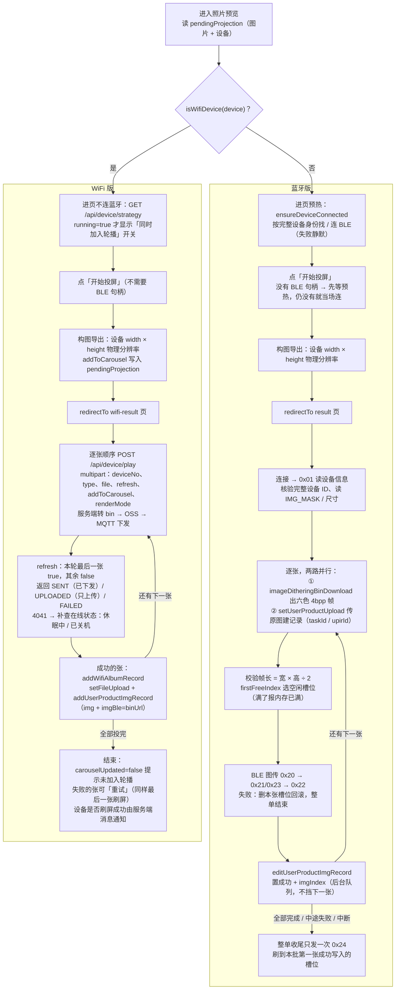

# 蓝牙版与 WiFi 版投屏流程对比（进入照片预览之后）

> 状态：current
> 最后核对：2026-10-28（`main-wifi`）
> 代码入口：预览 `subpackages/projection/preview/preview-page.js`；蓝牙版结果页 `subpackages/projection/result/result.js`；WiFi 版结果页 `subpackages/projection/wifi-result/wifi-result.js` + `utils/wifi-projection.js`

两条主线在预览页**构图导出**之前完全相同，分叉点只有两处：进页时做什么（预热蓝牙 / 查轮播）、导出后跳哪个结果页。

## 流程图

## 区别速查

| 环节 | 蓝牙版 | WiFi 版 |
| --- | --- | --- |
| 进预览页 | 预热 BLE 连接 | 查轮播状态（决定是否显示「同时加入轮播」） |
| 开始投屏前 | 必须拿到本机 BLE 句柄 | 不连蓝牙 |
| 构图导出 | 相同：设备物理分辨率 | 相同；`type` 也同口径（2026-10-28 起取产品屏幕方向 `screenType`，没配才按分辨率回退） |
| 结果页 | `result` | `wifi-result` |
| 出帧 | 小程序调 `imageDitheringBinDownload` 拿帧，端上校验帧长 | 服务端在 `/api/device/play` 里转 bin，端上不碰帧 |
| 传到设备 | BLE 0x20~0x22 分包，端上选槽位 | 服务端经 MQTT 下发，端上不选槽位 |
| 记录 | 先 `setUserProductUpload` 建记录，图传成功后 `editUserProductImgRecord` 置成功 + `imgIndex` | 投屏成功后 `addWifiAlbumRecord` 一次写好（`imgBle` = `binUrl`） |
| 刷屏 | 整单收尾一次 0x24 | 最后一张 `refresh=true` |
| 成功判定 | 设备 0x22 应答 | 接口返回 SENT / UPLOADED 即结束，不等设备 ack |
| 中途失败 | 回滚本张槽位、整单结束（已成功的张算部分成功） | 记为失败、继续下一张，结束后可重试失败的张 |
| 额外能力 | — | 同时加入轮播；4041 区分休眠 / 关机 |

注：WiFi 版刷屏只挂在本轮最后一张上，最后一张失败时这一轮不会刷屏（前面 UPLOADED 的张已在云端，重试时最后一张仍带 `refresh=true`）。

细节与约束：蓝牙版见 [图片投屏流水线](../architecture/image-projection-pipeline.md)；WiFi 版见 [V1.4 对接变更记录](../changes/2026-10-27-WiFi版V1.4对接.md)、[同时加入轮播](../changes/2026-10-28-WiFi版轮播上限100与同时加入轮播.md)。
